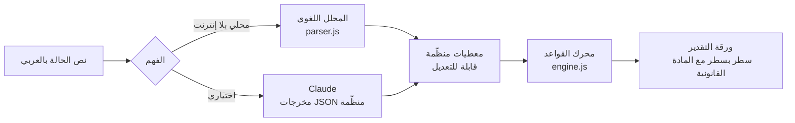

# المقدّر الذكي

نظام ذكاء اصطناعي يقرأ وصف حالة المكلف بالعربية، ويستخرج معطياتها، ويحسب الضريبة حسب القانون الفلسطيني، ثم يُخرج **ورقة تقدير** كاملة. كل سطر في الورقة يذكر كيف حُسب والمادة القانونية التي استند إليها.

> أداة تعليمية مبنية على كتاب «المحاسبة الضريبية وتطبيقاتها في فلسطين» (الفصول 1 و2 و3 و4 و8)، وعلى قرار بقانون ضريبة الدخل رقم 8 لسنة 2011 وتعديلاته. ليست استشارة ضريبية.

## الفكرة

النماذج اللغوية ممتازة في فهم الكلام، لكنها قد تخطئ في الحساب. لذلك يفصل المشروع بين مرحلتين:



1. **الفهم:** المحلل المحلي (`src/parser.js`) يتعرف على الرواتب والإيجارات والمكافآت والتبرعات والطلاب وقروض السكن وغيرها، ويفهم الأرقام العربية و«8 آلاف». ويمكن بدلاً منه تفعيل Claude، فيفهم أي صياغة ويكتب افتراضاته.
2. **المراجعة:** تظهر المعطيات في نموذج قابل للتعديل («ما فهمه المقدّر»)، فيصحح المستخدم أي رقم.
3. **الحساب:** المحرك (`src/engine.js`) يطبق القواعد بدقة ويعيد كل سطر مع شرحه ومرجعه.

## ما يحسبه

| التبويب | المحتوى |
|---|---|
| شخص طبيعي | الشرائح 5% و10% و15%، وإعفاء المقيم 36000، والمواصلات (الأقل بين الفعلي و10% في الخاص، والبدل الثابت في العام)، والتقاعد والتأمين الصحي، والجامعي 6000 لطالبين كحد أقصى، والسكن (30000 مرة واحدة أو فوائد 4000 لعشر سنوات)، ومكافأة نهاية الخدمة (شهر عن كل سنة، وشهران للجامعات)، وبدل التمثيل، وحصص شركات الأشخاص، والإيجار مع تقاص 60% من ضريبة الأملاك بحد ضريبة الإيجار، والخسائر (5 فترات)، والتبرعات (20%)، والتقاص من المقتطع والسلف |
| شركة | 15%، و20% للاتصالات، وحدود المصاريف (الضيافة، والبحث والتطوير، والتأسيس على 5 سنوات، والتدريب 2%، والديون المعدومة)، والمصاريف المرفوضة، وأول 300000 من الدخل الزراعي للشخص المعنوي، وخسائر فترة الإعفاء |
| ضريبة القيمة المضافة | قيود اليومية، والكشف الدوري (صفقات 16% وصفر ومعفاة)، والمبالغ الشاملة للضريبة، والفواتير الأقدم من 6 شهور، ومدخلات الصفقات المعفاة، وتصنيف المكلف (مرخص أو صغير أو معفى) |
| الاستيراد | سعر الاستيراد CIF، والرسوم النسبية والنوعية والمركبة والحد الأدنى، وتعلية السعر، والدفعات الإلزامية، وضريبة الشراء، وض.ق.م على الاستيراد |
| تصنيف الصفقات | معفاة أو نسبة صفر أو 16%، حسب قوائم الكتاب |

## التحقق من الدقة

المحرك مختبر على أسئلة امتحانات سابقة ومسائل الكتاب (`tests/engine.test.js`)، منها:

- امتحان النجاح، حالة حمدي: **3984**
- نموذج 1: مصطفى **0**، وأحمد **18810**، وسعيد **7650**، ومحمد **3600** للدفع، والاستيراد **38000 / 68400 / 47424**، ومحلات سامر **9504**، وتصنيف الصفقات العشر، والشركة المتحدة **16500**
- مثال الكتاب في تقاص الأملاك، وشركة مساهمة عامة **164000**، وشركة كبيرة **1395600**، وأمثلة الفصل 8 وتدريباته

تعمل الاختبارات تلقائياً في GitHub Actions مع كل تعديل، ولا يُنشر الموقع إلا إذا نجحت.

```bash
npm test
```

## التشغيل

- **على الإنترنت:** من رابط GitHub Pages الخاص بالمستودع.
- **محلياً:** `npm start` ثم افتح `http://localhost:5173`. ويمكن فتح `index.html` مباشرة أيضاً.

## وضع Claude (اختياري)

من زر «إعداد Claude» أدخل مفتاح Anthropic API. المفتاح يُحفظ في متصفحك فقط، ويُرسل مباشرة إلى `api.anthropic.com`.

- النموذج: `claude-opus-5-5` بجهد منخفض، مع مخرجات JSON مقيّدة بمخطط (structured outputs)، فلا يمكن أن يرجع حقلاً خارج المخطط.
- مفعّل فيه الرجوع التلقائي لنموذج بديل (`fallbacks: "default"`) إذا رفض النموذج طلباً.
- النموذج **لا يحسب** أي رقم: يملأ الحقول ويكتب افتراضاته فقط، والحساب كله في المحرك.

## إضافة فصل جديد

القواعد الرقمية كلها في كائن `RULES` أعلى `src/engine.js`، وتصنيف الصفقات في `VAT_CLASSES`. لإضافة فصل: أضف القاعدة، ثم أضف اختباراً من أمثلة الفصل في `tests/engine.test.js`.

## هيكل المشروع

```
index.html            الواجهة
styles.css            التصميم (ورقة تقدير رسمية)
src/engine.js         محرك القواعد
src/parser.js         المحلل اللغوي العربي
src/app.js            منطق الواجهة ووضع Claude
tests/engine.test.js  الاختبارات
tools/serve.js        خادم محلي
.github/workflows/    الاختبار والنشر التلقائي
```
